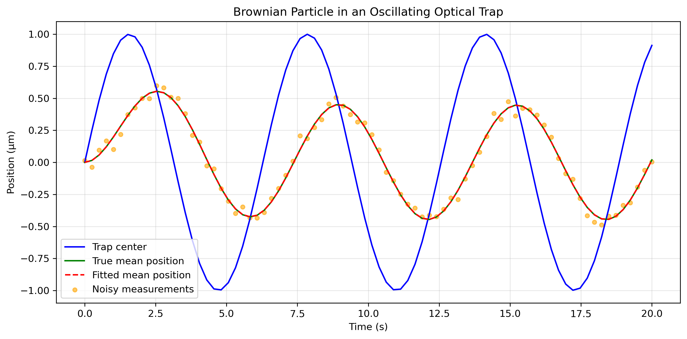

# Brownian Particle in an Oscillating Optical Trap

**Scientific Computing | Parameter Estimation | Monte Carlo Analysis | Interactive Streamlit Dashboard**

A Python-based scientific computing project investigating the mean response of an overdamped Brownian particle confined in an oscillating harmonic optical trap.

The project combines mathematical modeling, numerical simulation, synthetic data generation, parameter estimation, Monte Carlo analysis, and interactive visualization.

## 1. Project Goals

The main goals of this project are to:

1. Model the mean motion of a Brownian particle in an oscillating optical trap.
2. Solve the governing differential equation numerically using SciPy.
3. Generate reproducible synthetic measurements with Gaussian noise.
4. Estimate the relaxation time from noisy observations.
5. Evaluate the variability of parameter estimates through Monte Carlo simulations.
6. Investigate the frequency-dependent amplitude response and phase lag.
7. Develop an interactive Streamlit dashboard for exploring the physical model.

The project demonstrates how computational physics and statistical data analysis can be integrated into a reproducible Python workflow.

## 2. Physical Model

The optical trap center oscillates sinusoidally:

$$
c(t)=A\sin(\omega t)
$$

where:

- \(A\) is the oscillation amplitude.
- \(\omega\) is the angular driving frequency.
- \(t\) is time.

The ensemble-mean particle position \(m(t)\) satisfies the overdamped relaxation equation:

$$
\frac{dm}{dt}=-\frac{m(t)-c(t)}{\tau}
$$

where \(\tau\) is the characteristic relaxation time.

The initial condition is:

$$
m(0)=0
$$

### Physical interpretation

- **Small relaxation time:** The particle responds quickly to changes in the trap position.
- **Large relaxation time:** The particle responds more slowly and exhibits stronger attenuation and phase lag at a fixed driving frequency.

The differential equation is solved numerically using `scipy.integrate.odeint`.

**Modeling scope:** The simulation describes the deterministic ensemble-mean position. Synthetic Gaussian measurement noise is added afterward. Individual stochastic Brownian trajectories are not explicitly simulated in the current implementation.

## 3. Synthetic Data Generation

Synthetic measurements are generated by adding Gaussian noise to the numerically calculated mean trajectory:

$$
m_{\mathrm{measured}}(t_i)
=
m_{\mathrm{true}}(t_i)+\epsilon_i
$$

with

$$
\epsilon_i\sim\mathcal{N}(0,\sigma^2)
$$

Here, \(\sigma\) is the standard deviation of the additive Gaussian measurement noise.

Fixed random seeds ensure reproducibility.

### Default simulation parameters

| Parameter | Value |
|---|---|
| Trap amplitude | 1.0 µm |
| Angular frequency | 1.0 rad/s |
| True relaxation time | 2.0 s |
| Measurement noise | 0.05 µm |
| Simulation interval | 0–20 s |
| Number of observations | 80 |
| Monte Carlo repetitions | 100 |

## 4. Parameter Estimation

The relaxation time is estimated by minimizing the sum of squared residuals between the model prediction and the noisy measurements:

$$
\hat{\tau}
=
\underset{0.1\leq\tau\leq5}{\mathrm{arg\,min}}
\sum_{i=1}^{N}
\left[
m_{\mathrm{model}}(t_i;\tau)
-
m_{\mathrm{measured}}(t_i)
\right]^2
$$

The implementation uses `scipy.optimize.minimize_scalar` with bounded optimization.

The fitting algorithm receives the measured particle positions and the known driving parameters \(A\) and \(\omega\). It does **not** receive the true relaxation time.

### Example result

```text
True relaxation time:       2.0000 s
Estimated relaxation time:  2.0052 s
Minimum squared error:      0.118527 µm²
```

The estimated relaxation time closely matches the true value for this synthetic dataset.

## 5. Monte Carlo Analysis

A single noisy dataset produces one relaxation-time estimate. Different realizations of measurement noise produce slightly different estimates.

To study this variability, the project performs repeated synthetic experiments.

For each Monte Carlo realization:

1. Generate a new noisy dataset.
2. Estimate the relaxation time.
3. Store the estimated value.
4. Repeat the procedure.

The mean of the estimates is:

$$
\overline{\hat{\tau}}
=
\frac{1}{N_{\mathrm{MC}}}
\sum_{j=1}^{N_{\mathrm{MC}}}\hat{\tau}_j
$$

The sample standard deviation measures variation among individual fitted relaxation times.

The standard error of the Monte Carlo mean is approximately:

$$
\mathrm{SE}(\overline{\hat{\tau}})
=
\frac{s_{\hat{\tau}}}{\sqrt{N_{\mathrm{MC}}}}
$$

These are different statistical quantities.

### Example results

```text
Number of simulations:       100
Mean estimated tau:          2.0030 s
Sample standard deviation:   0.0367 s
```

The histogram of estimated relaxation times provides a visual representation of the estimator's variability.

## 6. Frequency-Response Analysis

After the initial transient, the particle's mean position approaches a periodic steady state:

$$
m_{\mathrm{ss}}(t)
=
\frac{A}{\sqrt{1+(\omega\tau)^2}}
\sin(\omega t-\phi)
$$

The phase lag is:

$$
\phi(\omega)=\arctan(\omega\tau)
$$

### Amplitude response

$$
R(\omega)
=
\frac{1}{\sqrt{1+(\omega\tau)^2}}
$$

### Phase lag

$$
\phi(\omega)=\arctan(\omega\tau)
$$

### Time lag

$$
\Delta t(\omega)
=
\frac{\arctan(\omega\tau)}{\omega}
$$

### Physical interpretation

At low frequencies, the mean particle position follows the moving trap relatively closely.

At high frequencies, the oscillation amplitude decreases and the phase lag approaches 90 degrees.

Although the phase lag increases, the corresponding time lag decreases as the frequency increases.

The analytical frequency-response formulas describe the periodic steady state, while the numerical trajectories may include an initial transient.

## 7. Scientific Visualizations

### Particle Motion and Parameter Estimation



This figure compares:

- Oscillating trap center
- True mean particle position
- Synthetic noisy measurements
- Fitted mean particle trajectory

It illustrates the delayed response and the agreement between the true and fitted trajectories.

### Monte Carlo Histogram


The histogram displays the distribution of estimated relaxation times across repeated noisy experiments.

Reference lines indicate the true relaxation time and the Monte Carlo mean.

### Frequency Response


The frequency-response figure displays:

- Amplitude ratio
- Phase lag
- Time lag

as functions of the angular driving frequency.

## 8. Interactive Streamlit Dashboard

The project includes an interactive dashboard developed using Streamlit.

Users can modify the simulation parameters and explore the resulting particle dynamics and parameter estimates.

### Adjustable parameters

- Trap amplitude \(A\)
- Angular frequency \(\omega\)
- True relaxation time \(\tau\)
- Measurement noise \(\sigma\)

### Dashboard outputs

- True relaxation time
- Estimated relaxation time
- Estimation error
- Particle-motion visualization
- Monte Carlo histogram
- Frequency-response plots

Users can select which visualizations to display.

**Note:** The true relaxation time is used only to generate synthetic observations. The optimization procedure estimates the relaxation time independently from those observations.

## 9. Project Structure

```text
brownian-particle-optical-trap/
│
├── src/
│   ├── app.py
│   ├── main.py
│   ├── model.py
│   ├── synthetic_data.py
│   ├── parameter_estimation.py
│   ├── monte_carlo.py
│   ├── visualization.py
│   └── frequency_response.py
│
├── particle_motion.png
├── monte_carlo_histogram.png
├── frequency_response.png
├── requirements.txt
├── .gitignore
└── README.md
```

### Module descriptions

| File | Purpose |
|---|---|
| `model.py` | Defines trap motion and solves the mean-position differential equation |
| `synthetic_data.py` | Generates synthetic noisy measurements |
| `parameter_estimation.py` | Estimates the relaxation time using numerical optimization |
| `monte_carlo.py` | Performs repeated parameter-estimation experiments |
| `visualization.py` | Generates particle-motion and Monte Carlo plots |
| `frequency_response.py` | Calculates and plots the frequency response |
| `main.py` | Runs the scientific analysis |
| `app.py` | Provides the interactive Streamlit dashboard |
| `requirements.txt` | Specifies Python project dependencies |

## 10. Installation

### Prerequisites

- Python 3.10 or newer
- Git
- A Python virtual environment is recommended

### Step 1: Clone the repository

```bash
git clone https://github.com/maryamakaberian/brownian-particle-optical-trap.git

cd brownian-particle-optical-trap
```

### Step 2: Create a virtual environment

On Linux, macOS, or WSL:

```bash
python3 -m venv .venv
source .venv/bin/activate
```

On Windows PowerShell:

```powershell
python -m venv .venv
.venv\Scripts\Activate.ps1
```

### Step 3: Install dependencies

```bash
python -m pip install -r requirements.txt
```

The main dependencies are:

- NumPy
- SciPy
- Matplotlib
- Streamlit

The `requirements.txt` file contains the dependency specifications for the project.

## 11. How to Run

Run the following commands from the repository root.

### Option A: Run the scientific simulation

```bash
python src/main.py
```

This executes the numerical simulation, generates synthetic measurements, estimates the relaxation time, performs Monte Carlo analysis, and generates the scientific figures.

Depending on the Matplotlib backend, plot windows may appear during execution.

### Option B: Run the Streamlit dashboard

```bash
python -m streamlit run src/app.py
```

Streamlit starts a local web application.

Open the displayed address, usually:

```text
http://localhost:8501
```

Use the sidebar to adjust the simulation parameters and select the visualizations.

## 12. Example: Exploring Relaxation Dynamics

Consider:

$$
A=1\,\mu\mathrm{m}
$$

$$
\omega=1\,\mathrm{rad/s}
$$

$$
\tau=2\,\mathrm{s}
$$

The steady-state amplitude ratio is:

$$
R=\frac{1}{\sqrt{5}}\approx0.447
$$

The phase lag is:

$$
\phi=\arctan(2)\approx63.4^\circ
$$

The corresponding time lag is:

$$
\Delta t\approx1.107\,\mathrm{s}
$$

The particle's mean position therefore oscillates with approximately 44.7% of the trap amplitude and lags behind the trap motion.

### Suggested dashboard experiment

1. Set the amplitude to 1 µm.
2. Set the angular frequency to 1 rad/s.
3. Compare relaxation times of 0.5 s and 4.0 s.
4. Observe changes in the particle response.
5. Increase the measurement noise.
6. Examine the fitted relaxation time and Monte Carlo histogram.

This experiment illustrates the relationship between physical relaxation dynamics and parameter-estimation uncertainty.

## 13. Numerical and Statistical Methods

| Method | Python tool | Application |
|---|---|---|
| Numerical integration | `scipy.integrate.odeint` | Solve the differential equation |
| Array operations | NumPy | Numerical calculations |
| Random sampling | NumPy random generator | Generate Gaussian noise |
| Numerical optimization | `scipy.optimize.minimize_scalar` | Estimate relaxation time |
| Monte Carlo simulation | Python and NumPy | Analyze estimator variability |
| Scientific visualization | Matplotlib | Generate scientific figures |
| Interactive application | Streamlit | Explore simulation parameters |

## 14. Assumptions and Limitations

The current model assumes:

- One-dimensional overdamped dynamics.
- A sinusoidally driven harmonic trap.
- A constant relaxation time.
- Gaussian additive measurement noise.
- Known trap amplitude and driving frequency during fitting.
- Synthetic measurements of the mean particle position.
- A bounded parameter-estimation interval of 0.1–5 seconds.

The current implementation does not explicitly simulate individual stochastic Brownian trajectories.

## 15. Future Improvements

Possible extensions include:

- Uploading experimental measurements to the dashboard.
- Estimating relaxation time from real experimental data.
- Adding confidence intervals and residual diagnostics.
- Investigating the influence of noise and sampling frequency.
- Simulating stochastic Brownian trajectories using a Langevin equation.
- Adding animations of particle and trap motion.
- Introducing automated tests.
- Pinning and validating dependency versions.
- Deploying the Streamlit dashboard publicly.

## 16. Skills Demonstrated

**Scientific computing:** Numerical differential equations, dynamical systems, relaxation processes, and frequency-response analysis.

**Data analysis:** Synthetic data generation, parameter estimation, optimization, and Monte Carlo uncertainty analysis.

**Python programming:** NumPy, SciPy, Matplotlib, Streamlit, and modular software development.

**Reproducibility:** Fixed random seeds, dependency management, and Git-based version control.

**Scientific communication:** Visualization, mathematical modeling, and interpretation of numerical results.

## 17. Author

**Maryam Akaberian, PhD in Physics**

Background in statistical mechanics and theoretical physics, with an interest in scientific computing, data analysis, and data science.

[GitHub Profile](https://github.com/maryamakaberian)

[Project Repository](https://github.com/maryamakaberian/brownian-particle-optical-trap)

---

*This project demonstrates the integration of computational physics, numerical modeling, statistical inference, and interactive scientific visualization using Python.*
