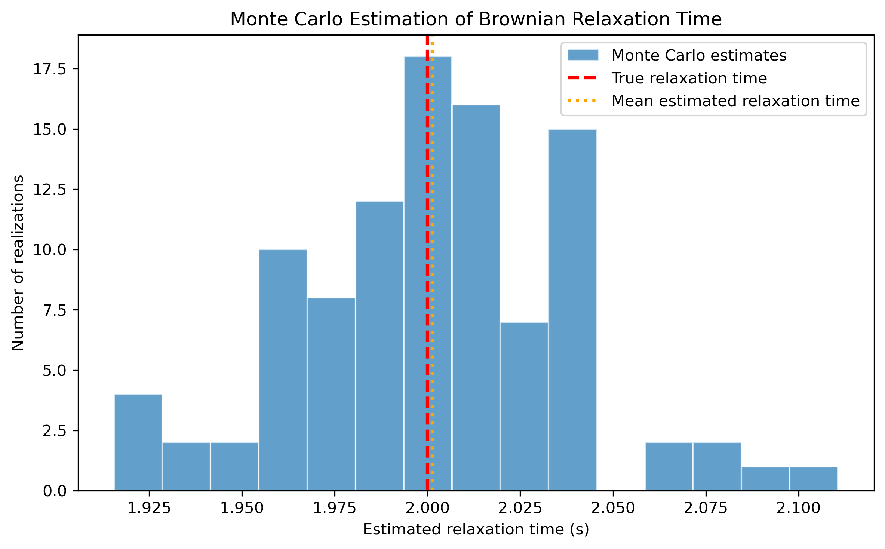
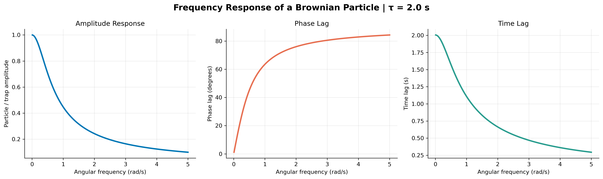

# Brownian Particle in an Oscillating Optical Trap

**Numerical Simulation · Parameter Estimation · Monte Carlo Analysis · Streamlit Dashboard**

A scientific Python project exploring the **mean motion of an overdamped Brownian particle** in a sinusoidally moving harmonic optical trap. It combines numerical differential-equation solving, synthetic measurement data, relaxation-time estimation, Monte Carlo analysis, frequency-response theory, and interactive visualization.

> **Scope:** The project simulates the *ensemble-mean trajectory* and adds synthetic measurement noise. It does **not** yet simulate individual stochastic Brownian trajectories using a Langevin equation.

## Project goals

- Model the delayed response of a particle's mean position to a moving optical trap.
- Solve the governing ODE numerically with SciPy.
- Generate reproducible noisy synthetic observations.
- Recover an unknown relaxation time from observations using optimization.
- Quantify variability in the estimate using Monte Carlo repetitions.
- Examine amplitude attenuation, phase lag, and time lag across driving frequencies.
- Explore results in an interactive Streamlit dashboard.

## Physical model

The trap center follows

$$
c(t)=A\sin(\omega t),
$$

where $A$ is the trap amplitude and $\omega$ is the angular driving frequency. The ensemble-mean particle position $m(t)=\langle x(t)\rangle$ obeys

$$
\frac{dm}{dt}=-\frac{m(t)-c(t)}{\tau}, \qquad m(0)=0,
$$

where $\tau>0$ is the relaxation time. A larger $\tau$ means a slower response to changes in the trap position. The numerical solution uses `scipy.integrate.odeint`.

### Synthetic measurements

The simulated observations are

$$
m_{\mathrm{measured}}(t_i)=m_{\mathrm{true}}(t_i)+\epsilon_i,
\qquad \epsilon_i\sim\mathcal N(0,\sigma^2).
$$

Here $\sigma$ is the standard deviation of additive Gaussian measurement noise. Fixed random seeds make the example reproducible.

### Parameter estimation

The relaxation time is estimated by minimizing the sum of squared residuals:

$$
\hat\tau=\underset{\tau>0}{\operatorname{argmin}}
\sum_{i=1}^{N}\left[m_{\mathrm{model}}(t_i;\tau)-m_{\mathrm{measured}}(t_i)\right]^2.
$$

The implementation uses `scipy.optimize.minimize_scalar` with bounded optimization. The fitter receives the measurements and known trap-driving parameters $A$ and $\omega$; **it does not receive the true relaxation time**.

### Monte Carlo analysis

The project repeatedly generates new noisy datasets, fits $\tau$ to each one, and examines the distribution of estimates. The sample standard deviation measures variation among *individual fitted relaxation times*. The standard error of their Monte Carlo mean is approximately $s_{\hat\tau}/\sqrt{N_{\mathrm{MC}}}$; these are different quantities.

### Frequency response

After the transient has decayed, the steady-state mean response is

$$
m_{\mathrm{ss}}(t)=\frac{A}{\sqrt{1+(\omega\tau)^2}}\sin(\omega t-\phi),
\qquad \phi=\arctan(\omega\tau).
$$

The frequency-response quantities are:

$$
\text{Amplitude ratio:}\quad R(\omega)=\frac{1}{\sqrt{1+(\omega\tau)^2}}
$$

$$
\text{Phase lag:}\quad \phi(\omega)=\arctan(\omega\tau)
$$

$$
\text{Equivalent time lag:}\quad \Delta t(\omega)=\frac{\phi(\omega)}{\omega}.
$$

Increasing the driving frequency suppresses the particle's response amplitude and increases the phase lag toward $90^\circ$. The equivalent time lag decreases at high frequencies, even though the amplitude response becomes very small.

## Example results

Default parameters used in the command-line analysis:

| Parameter | Value |
|---|---:|
| Trap amplitude $A$ | 1.0 µm |
| Angular frequency $\omega$ | 1.0 rad/s |
| True relaxation time $\tau$ | 2.0 s |
| Measurement noise $\sigma$ | 0.05 µm |
| Observation interval | 0–20 s |
| Number of observations | 80 |
| Monte Carlo repetitions | 100 |

Example output with the specified random seeds:

```text
True relaxation time: 2.0000 s
Estimated relaxation time: 2.0052 s
Minimum squared error: 0.118527 µm²
Number of simulations: 100
Mean estimated tau: 2.0030 s
Standard deviation: 0.0367 s
```

These results illustrate accurate parameter recovery for the example synthetic dataset; one successful fit does not establish that the estimator is unbiased in general.

For $\omega=1\,\mathrm{rad/s}$ and $\tau=2\,\mathrm{s}$, the theoretical steady-state amplitude ratio is approximately **0.447**, the phase lag is **63.4°**, and the equivalent time lag is **1.107 s**.

## Visualizations

### Particle motion and fitted response


The moving trap leads the mean particle position. The fitted and true mean trajectories nearly overlap for the default example, while the synthetic measurements scatter around them.

### Monte Carlo histogram



The histogram shows the variation in fitted relaxation times across repeated noisy datasets, with reference lines for the true relaxation time and the mean estimate.

### Frequency response



The three panels summarize the system's **steady-state** response as the driving frequency changes.

## Interactive Streamlit dashboard

The Streamlit app allows users to adjust:

- Trap amplitude $A$ (µm)
- Angular frequency $\omega$ (rad/s)
- **True** relaxation time $\tau$ (s), used to generate synthetic data
- Measurement noise $\sigma$ (µm)

It displays the estimated relaxation time and estimation error, with selectable views for particle motion, the Monte Carlo histogram, and frequency response.

**Important:** The true $\tau$ slider defines the simulated experiment. The optimization independently estimates $\hat\tau$ from noisy observations. A future experimental-data mode could accept uploaded measurements without requiring a known true relaxation time.

## Repository structure

```text
brownian-particle-optical-trap/
├── src/
│   ├── app.py                  # Streamlit dashboard
│   ├── main.py                 # Command-line analysis
│   ├── model.py                # Trap center and ODE solver
│   ├── synthetic_data.py       # Noisy synthetic observations
│   ├── parameter_estimation.py # Relaxation-time fitting
│   ├── monte_carlo.py          # Repeated noisy experiments
│   ├── visualization.py        # Particle motion and histogram plots
│   └── frequency_response.py   # Frequency-response visualization
├── frequency_response.png
├── particle_motion.png
├── monte_carlo_histogram.png
├── .gitignore
├── requirements.txt          # Python dependencies
└── README.md
```

## Installation and running

**Requirements:** Python 3.10+ and the packages NumPy, SciPy, Matplotlib, and Streamlit.

### 1. Clone the repository

```bash
git clone https://github.com/maryamakaberian/brownian-particle-optical-trap.git
cd brownian-particle-optical-trap
```

### 2. Create a virtual environment

Linux, macOS, or WSL:

```bash
python3 -m venv .venv
source .venv/bin/activate
```

Windows PowerShell:

```powershell
python -m venv .venv
.venv\Scripts\Activate.ps1
```

### 3. Install dependencies

```bash
python -m pip install -r requirements.txt
```

The `requirements.txt` file lists the four required packages: `numpy`, `scipy`, `matplotlib`, and `streamlit`. Versions are not pinned yet, so installations may resolve to newer compatible releases.

### 4A. Run the scientific analysis

From the repository root:

```bash
python src/main.py
```

This generates the example data, estimates $\tau$, runs the Monte Carlo analysis, and produces PNG visualizations in the working directory. Depending on the Matplotlib backend, you may need to close plot windows for execution to continue.

### 4B. Run the Streamlit dashboard

From the repository root:

```bash
python -m streamlit run src/app.py
```

Open the URL printed in the terminal, typically **http://localhost:8501**. Use the sidebar to adjust parameters and choose which plots to display.

## Try it yourself

1. **Explore relaxation:** Keep $A=1\,\mu\mathrm m$ and $\omega=1\,\mathrm{rad/s}$, then vary the true $\tau$ from 0.5 to 4 s. Observe changes in the response amplitude and delay.
2. **Increase noise:** Raise $\sigma$ while keeping the other parameters fixed. Compare the fitted relaxation time and the spread of measurements.
3. **Explore uncertainty:** Enable the Monte Carlo histogram and compare repeated estimates with the true parameter.
4. **Inspect frequency dependence:** Enable the frequency-response view to see amplitude attenuation, phase lag, and time lag across frequencies.

## Methods and tools

| Tool | Purpose |
|---|---|
| Python | Modular scientific application |
| NumPy | Numerical arrays and random sampling |
| SciPy `odeint` | ODE solution |
| SciPy `minimize_scalar` | Bounded least-squares parameter fitting |
| Matplotlib | Scientific plots |
| Streamlit | Interactive dashboard |
| Git / GitHub | Version control and sharing |

## Assumptions and limitations

- One-dimensional, overdamped, linear relaxation model.
- Prescribed sinusoidal trap motion.
- Constant relaxation time.
- Additive Gaussian measurement noise on the **mean** trajectory.
- Known trap amplitude and angular frequency during fitting.
- Numerical trajectories include the initial transient; analytical frequency-response expressions describe steady state.
- Individual stochastic trajectories and full experimental-data fitting are not yet implemented.

## Future improvements

- Upload and fit real experimental time-series data.
- Add estimator diagnostics and confidence intervals.
- Simulate individual Brownian trajectories with a Langevin equation.
- Add animation of the moving trap and particle response.
- Introduce automated tests and pin tested dependency versions for reproducible deployments.
- Deploy the Streamlit dashboard publicly.

## Author

**Maryam Akaberian, PhD in Physics**  
Background in statistical mechanics and theoretical physics; interested in scientific computing, data analysis, and data science.

[GitHub profile](https://github.com/maryamakaberian) · [Project repository](https://github.com/maryamakaberian/brownian-particle-optical-trap)

---

*This project demonstrates a reproducible workflow connecting physical modeling, numerical simulation, statistical estimation, and interactive scientific visualization.*
